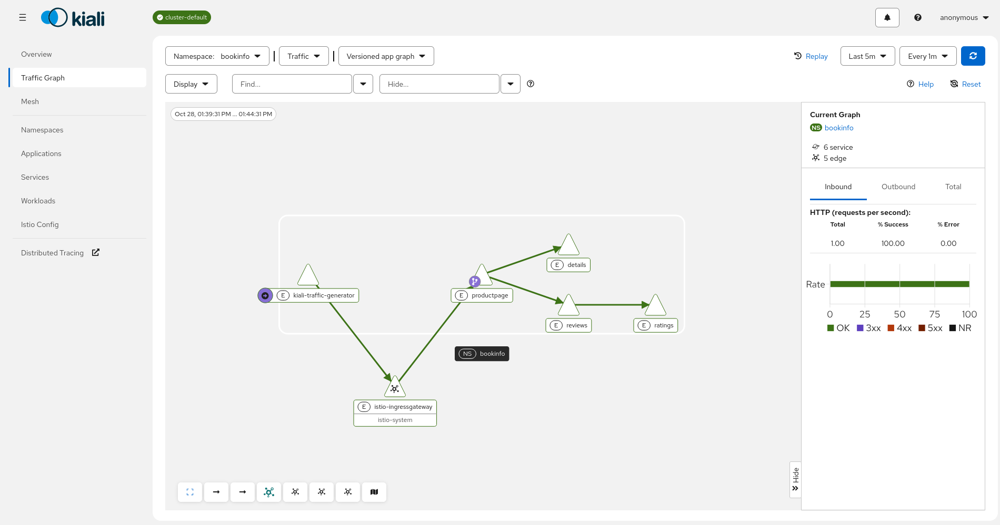

# Bookinfo trace topology PoC

PoC for [kiali/kiali#10413](https://github.com/kiali/kiali/issues/10413), using
Bash scripts, declarative YAML, and existing Kiali hack installers.

```text
kiali-traffic-generator -> productpage -> details
                                     -> reviews -> ratings
                              |
                        Envoy OTLP spans
                              v
                      OTel service_graph
                              |
                      Prometheus exporter
                              |
                  recording rule -> Kiali extension
```

The Collector also forwards complete traces to the Istio Jaeger addon. Istio
traffic metrics are disabled in Bookinfo; Prometheus scrapes the Collector in
addition to its usual targets. Kiali consumes `kiali_ext_requests_total` through
its existing ExtensionsAppender. No Kiali backend or frontend changes are
required, and the PoC does not enable the experimental `telemetryVendor=tracing`
branch.



## Run

Requirements: Bash, Docker, kind, kubectl, Helm, curl, jq, Mike Farah yq,
and `envsubst`.

```bash
hack/tracing-graph-poc/run.sh up
hack/tracing-graph-poc/run.sh access
# In another terminal, allow about a minute for telemetry to warm up:
hack/tracing-graph-poc/run.sh verify
```

`up` does the full lab: Kind (via `hack/start-kind.sh` if missing), Sail/Istio
with prometheus+jaeger addons, OTel Collector, Prometheus ConfigMap patch,
Kiali, and Bookinfo (traces-only Telemetry + traffic generator sidecar).
`bookinfo` alone re-runs only the app layer. `verify-bookinfo` is an alias for
`verify`.

Cluster name defaults to `tracing-graph-poc` (`POC_CLUSTER`). Artifacts default
to `_output/tracing-graph-poc/` (`POC_OUT`).

## Reused Kiali scripts

- `hack/start-kind.sh` provisions the Kind cluster (MetalLB included).
- `hack/istio/install-istio-via-sail.sh -a "prometheus jaeger" -pf istio-patch.yaml`
  installs Sail, Istio, and the stock prometheus/jaeger addons. The patch points
  the `otel-tracing` extension provider at this PoC's Collector.
- `hack/istio/download-istio.sh` + `hack/istio/install-bookinfo-demo.sh` deploy
  upstream Bookinfo and `kiali-test-mesh-traffic-generator`.

The shared Bookinfo installer excludes its traffic generator from sidecar
injection by default. The PoC patches only its own `kiali-traffic-generator`
ReplicaSet to inject a sidecar and recreates that pod. The installer script is
not modified.

Prometheus is **not** redeployed: `observability.sh` patches the addon
ConfigMap (same pattern as `hack/prometheus/federation/demo/install.sh`):

1. Append scrape job `otel-service-graph` → `otel-collector:8889`
2. Merge recording rules from `rules.yaml` into `recording_rules.yml`
3. `rollout restart deployment/prometheus`

## Access and verification

Keep `run.sh access` running:

- [Kiali](http://localhost:21001/kiali): select namespace **bookinfo**. Expect five
  extension service nodes and four edges. Reviews versions aggregate into one node.
- [Bookinfo](http://localhost:18080/productpage).
- [Prometheus](http://localhost:19090): inspect `traces_service_graph_request_total`
  and `kiali_ext_requests_total`.
- [Jaeger](http://localhost:17686): search service `productpage` for full traces.

`verify.sh` checks native connector edges, positive HTTP 200 rates, the same
four edges and five extension nodes in Kiali, a complete trace with at least
eight spans across all five services, seven ready sidecars, absence of Istio
request metrics in Prometheus, and absence of `istio_requests_total` on Bookinfo
Envoy endpoints. It retries while counters warm up and excludes traces from the
most recent 20 seconds because proxies flush their spans independently.

Evidence is saved to `${POC_OUT}/bookinfo-evidence.json`; individual API responses
and proxy metrics are in `${POC_OUT}/verification/`.

```bash
hack/tracing-graph-poc/run.sh status
hack/tracing-graph-poc/run.sh down
```

## Configuration and limits

- Collector Contrib `0.164.0` uses `service_graph`, one replica, and Recreate
  rollouts. Both sides of an edge must reach the same Collector. Scaling requires
  trace-aware routing rather than independent random balancing.
- `collector.yaml` normalizes Envoy `app.namespace` service names into
  `service.name` + `service.namespace` for any namespace (K8s namespaces have no
  dots), copies the namespace into span attributes for connector dimensions, and
  maps the older `http.status_code` to `http.response.status_code`. Port 4317 is
  named `grpc-4317` so Istio uses HTTP/2 to export traces.
- `rules.yaml` adapts the native edge counter to Kiali's extension labels using
  actual SERVER HTTP status codes and requiring both namespace dimensions. Cluster
  labels default to Sail's `cluster-default` (`POC_MESH_CLUSTER`).
- Sampling is 100% here. With sampling, rates represent observed paired spans,
  not total requests. Extension nodes do not provide the full workload identity,
  health, security, or metrics shown by standard Istio telemetry.
- Mixing trace-derived edges with Istio metrics, deduplication, ambient, ingress
  topology, and multicluster are not validated.
- Storage is ephemeral. Anonymous Kiali and plaintext OTLP are for this local lab.

Optional overrides: `POC_CLUSTER`, `POC_OUT`, `POC_KIND_IMAGE`, `POC_MESH_CLUSTER`,
`ISTIO_VERSION` (Bookinfo distro download; default latest), `KIALI_CHART_DIR`.
